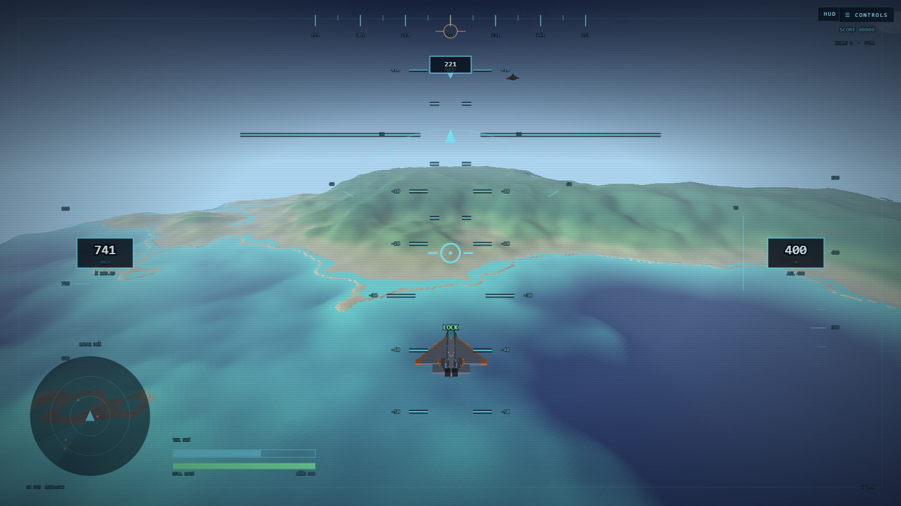
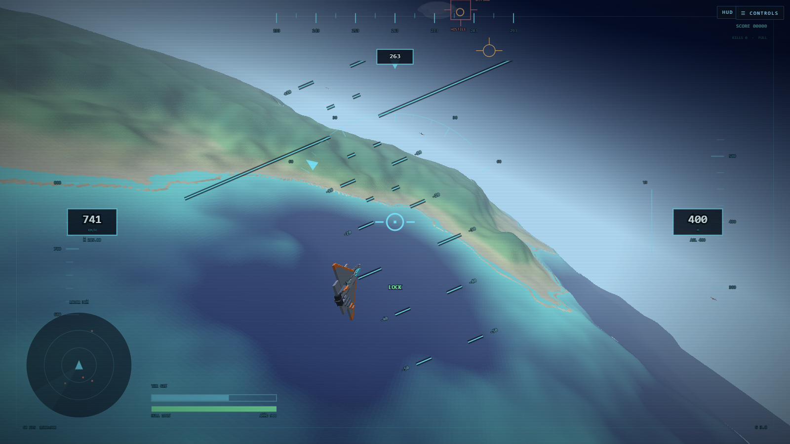

# AIR COMBAT 2026

零依赖、单文件的 3D 空战 demo：**地形在 GPU 上逐像素光线步进，战机是体素生成的 3D 网格，
HUD/特效/音效全部程序化生成**。没有 Three.js，没有引擎，没有任何外部资源，不需要构建。

<p align="center">
  
</p>
<p align="center">
  
</p>

## 在线试玩

**https://debriscraft.github.io/air-combat-2026/** ← 直接用浏览器打开，手机可能跑不动（需要 WebGL2）

本地：下载 `index.html` 双击打开即可，无需服务器、无需构建。

## 操作

| 输入 | 作用 |
| --- | --- |
| 鼠标移动 | 操控（压坡度 / 俯仰） |
| 左键 / `W` / `Shift` | 加力燃烧 |
| 滚轮 | 油门 |
| 右键 / 空格 | 开火 |
| `C` 或 `1` `2` `3` | 俯视 / 追尾 / 座舱（参数插值切换） |
| `H` | HUD 模式：OFF → LITE → FULL |
| `L` / `Tab` / `P` | 原理标注 / 参数面板 / 暂停 |

---

## 技术亮点

### 1. 地形在 GPU 上逐像素求解，而不是贴图或网格

没有顶点缓冲，没有地形网格。整个地形是**一个全屏三角形 + 一个片元着色器**：
每个像素发射一条射线，在 1024² 高度场纹理里自适应步进，命中后再做 6 次二分细化定位表面。

```glsl
for (int i = 0; i < 120; i++) {
  vec3 p = uCam + rd * t;
  float d = p.z - H(p.xy);      // 与地表的竖直距离
  if (d < 0.0) { hit = t; break; }
  t += max(3.0, d * 0.55);      // 离地远就迈大步，近了自动变细
}
```

代价是**分辨率与画面完全解耦**：窗口多大就是多大，2K、4K 都一样，不需要任何 LOD。
命中距离顺便写进 `gl_FragDepth`，所以后面的 3D 战机可以被山体正确遮挡。

### 2. 战机是体素表面抽取出来的三角网格

模型以 `122 × 122 × 42` 的体素定义（机身椭圆截面、三角翼、垂尾、座舱、挂弹都是隐式形状
逐体素求值出来的），再抽取表面朝向空的一侧生成四边形 → 约 2 万三角形送进 GPU。

好处是**姿态是真正的 3D 姿态**：横滚绕机身纵轴、俯仰绕横轴、偏航绕竖轴，由模型矩阵构造，
不再是「把 2D 精灵转个角度」——后者转出来的其实是偏航。

### 3. 只有 42% 的坡度喂给相机

转弯率 `34·tan(φ)/v`：坡度越大转得越快。但相机**只跟随 42% 的坡度**，
剩下 58% 体现在机体自身的横滚上 —— 所以你能同时看到「地平线斜了」和「飞机真的侧过来了」。
100% 跟随会变成镜头在转、飞机纹丝不动；0% 则会失去地平线参考。

### 4. 全程零素材

| 内容 | 来源 |
| --- | --- |
| 地形 | 6 八度值噪声 + 山脊 + 细节，`Math.imul` 哈希 |
| 地表着色 | 逐像素法线 + 朗伯光照 + 海拔分带（沙→草→林→岩→雪）+ 陡坡转岩石 + 指数雾 |
| 水面 | 深度色 + 正弦浪法线 + 反射向量与太阳方向夹角的镜面高光 |
| 战机 | 体素隐式建模 → 表面抽取 |
| 爆炸 | 加法混合径向渐变火球 + 扩张冲击波环 + 拖尾火花 + 上升烟团 + 全屏闪光 |
| HUD | Canvas2D 矢量绘制：姿态梯、坡度弧、速度/高度带、航向带、目标框 + 提前量、3 km 雷达、座舱仪表 |
| 音效 | WebAudio 程序化：锯齿波引擎 + 低通、噪声风噪、机炮、爆炸 |

### 5. 三视角共用一套相机

俯视 / 追尾 / 座舱不是三个相机，而是同一相机的位置、距离、FOV、座舱遮罩四组参数在插值，
切换时是连续的（`C` 键来回切能看到平滑过渡）。

---

## 两个版本

| 文件 | 实现 | 说明 |
| --- | --- | --- |
| `index.html` | WebGL2 地形 + 3D 网格战机 | 完整版，约 78 KB |
| `index-32kb.html` | 纯 Canvas2D + sprite stacking | 32 KB 约束版，像素风；`index.html` 在 WebGL2 不可用时也会回退到这套软件渲染路径 |

`index-32kb.html` 是「用一叠 2D 切片装 3D」的原始做法：`61×61×21` 体素切 21 层，
每层按高度平移绘制 = sprite stacking。它有几秒钟就能读懂的巧妙，也有绕不过去的几何限制
（画面内旋转切片其实是偏航），这正是后来把战机改成真网格的原因。

## 目录

```
index.html          完整版（单文件，可直接双击）
index-32kb.html     32KB 版本
shots/              截图
LICENSE             MIT
```

## 关于

本项目是对 2026 年 11 月 **UI8 Forge** 公共 demo *fighter* 的独立复刻：
技术路线相同（噪声高度图 + 三视角 HUD + 逐像素地形），**全部代码为重新实现**，未使用原作任何素材。

## License

[MIT](LICENSE)
